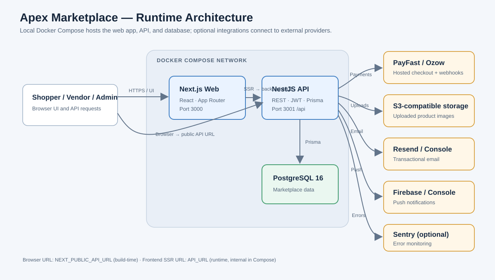
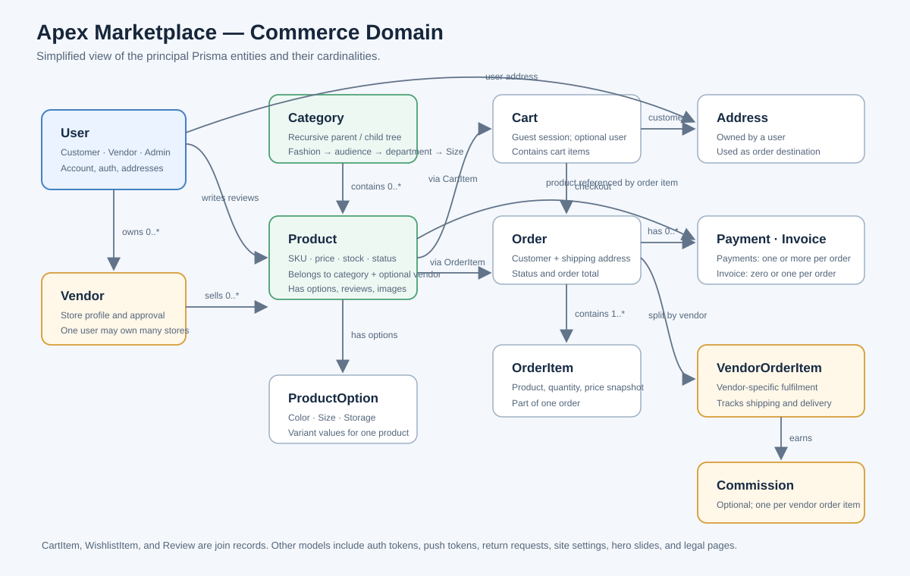

# Apex Marketplace

[](https://github.com/momotaun/Annah_E_Commerce/actions/workflows/ci.yml)

A multi-vendor e-commerce marketplace. Customers browse products and place orders, vendors manage their products and fulfilment, and admins manage vendors and site content. Payments can use PayFast or Ozow.

This repository is a monorepo with two independently deployable applications:

| Application | Directory | Stack |
|---|---|---|
| Web application | [`frontend/`](frontend/README.md) | Next.js 16 App Router, React 19, Tailwind CSS 4 |
| API | [`backend/`](backend/README.md) | NestJS 11, Prisma 6, PostgreSQL 16 |

This guide covers the overall architecture and running the complete project locally. See the [backend guide](backend/README.md) and [frontend guide](frontend/README.md) for app-specific details.

## Architecture

### Runtime architecture



In the Docker setup, the browser reaches the API at `http://localhost:3001/api`. Server-rendered frontend requests instead use the internal Compose address `http://backend:3001/api`. Images are stored using an optional S3-compatible service; email and push notifications use external providers when configured and console implementations otherwise.

### Commerce domain



The Prisma schema in [`backend/prisma/schema.prisma`](backend/prisma/schema.prisma) defines the database models and relations. Categories form a recursive tree; for example, Fashion categories include audience, department and Size levels. Products are assigned to a category and can have variant options such as color and size. An order belongs to a customer and shipping address, contains order-item snapshots, can have payments and an invoice, and may be split into vendor fulfilment items.

## Features

- Product catalogue, nested categories, search, product reviews, and vendor storefronts
- Session-based carts for guests and signed-in customers, checkout, order history, invoices, and return requests
- PayFast and Ozow payment gateways with provider-specific webhooks
- Vendor onboarding, product and inventory management, and order fulfilment
- Admin vendor approval, analytics, site branding, hero slides, and editable legal pages
- JWT authentication with access and rotating refresh tokens
- Optional S3-compatible image storage, Resend email, Firebase push notifications, and Sentry error reporting

## Prerequisites

- Docker Desktop with Docker Compose (recommended for the complete stack)
- Node.js 20 or later and npm (needed to run the seed script from the host or to run apps outside Docker)

The Docker Compose setup includes PostgreSQL 16. If you run services without Compose, provide a PostgreSQL 16 database yourself.

## Quick start: Docker Compose

Run these commands from the repository root in PowerShell:

```powershell
Copy-Item .env.example .env
Copy-Item backend\.env.example backend\.env
```

In `backend\.env`, replace `JWT_ACCESS_SECRET` and `JWT_REFRESH_SECRET` with two different, randomly generated secrets. For example, run this twice in PowerShell:

```powershell
node -e "console.log(require('crypto').randomBytes(50).toString('hex'))"
```

Start PostgreSQL, the API, and the web application:

```powershell
docker compose up -d --build
docker compose ps
```

The API container applies pending migrations and seeds default site branding when it starts. To load the sample catalogue and local demo accounts, run the full development seed once from the host:

```powershell
Set-Location backend
npm ci
npx prisma db seed
Set-Location ..
```

The full seed is intentionally run from the host: it creates accounts with known development passwords and refuses to run in production mode. It is idempotent and can be rerun to refresh seeded product/category data.

Open the application:

| Service | Address |
|---|---|
| Web application | [http://localhost:3000](http://localhost:3000) |
| API | [http://localhost:3001/api](http://localhost:3001/api) |
| API health check | [http://localhost:3001/api/health](http://localhost:3001/api/health) |
| PostgreSQL | `localhost:5432` |

### Seeded local accounts

The seed creates local test accounts. These credentials are for local development only; never use them in a deployed environment.

| Role | Email | Password |
|---|---|---|
| Admin | `admin@apex.co.za` | `adminPassword123` |
| Fashion vendor | `vendor@meridianapparel.co.za` | `vendorPassword123` |
| Customer | `customer@apex.co.za` | `customerPassword123` |

All seeded vendor accounts use `vendorPassword123`; see [`backend/prisma/seed.ts`](backend/prisma/seed.ts) for the other vendor emails and seeded data.

### Stop and restart

```powershell
docker compose down       # Stop containers; preserve the database volume
docker compose up -d      # Start again without rebuilding
docker compose logs -f    # Follow service logs; Ctrl+C exits log view
```

To delete the local database and all its data, use `docker compose down -v`. This is destructive and should only be used when you intentionally want a clean local database.

### Common local setup issues

- **A port is already in use:** stop the other process using port `3000`, `3001`, or `5432`, or edit the corresponding host-side port mapping in `docker-compose.yml`.
- **API does not become healthy:** check `docker compose logs backend postgres`; confirm both `.env` files exist and the JWT secrets are set.
- **Changes to `NEXT_PUBLIC_API_URL`:** this value is baked into the frontend image at build time. Rebuild with `docker compose up -d --build frontend` after changing it.
- **Payment, upload, email, or push features are unavailable:** set the corresponding optional provider credentials in `backend/.env`, then restart the backend. The core catalogue and account flows work without these integrations.

## Run without Docker

Use this option if you already have PostgreSQL 16 running locally.

1. Copy `backend/.env.example` to `backend/.env`.
2. Set `DATABASE_URL` to your PostgreSQL connection string and provide unique values for `JWT_ACCESS_SECRET` and `JWT_REFRESH_SECRET`.
3. In a terminal, install backend dependencies, migrate and seed the database, then start the API:

   ```powershell
   Set-Location backend
   npm ci
   npx prisma migrate dev
   npx prisma db seed
   npm run start:dev
   ```

4. In a second terminal, start the frontend:

   ```powershell
   Set-Location frontend
   npm ci
   npm run dev
   ```

The site runs at [http://localhost:3000](http://localhost:3000) and calls the API at `http://localhost:3001/api` by default. If the API uses another address, set `NEXT_PUBLIC_API_URL` in `frontend/.env.local` and restart the frontend.

## Environment and optional integrations

The root `.env` configures the PostgreSQL Compose service. `backend/.env` configures the API. Do not commit either file.

| Integration | Configuration | Behavior when not configured |
|---|---|---|
| Database | `DATABASE_URL` (overridden inside Compose to reach the `postgres` service) | Required |
| Authentication | `JWT_ACCESS_SECRET`, `JWT_REFRESH_SECRET` | Required |
| Payments | `PAYMENT_PROVIDER` (`payfast` by default or `ozow`), plus provider credentials | Payment initiation requires valid credentials; keep sandbox/test mode enabled during development |
| Email | `RESEND_API_KEY`, optionally `RESEND_FROM_EMAIL` | Uses console mailer; email links appear in backend logs |
| Product image uploads | `OBJECT_STORAGE_*` | Upload operations report that storage is not configured |
| Push notifications | `FIREBASE_SERVICE_ACCOUNT_JSON` | Uses console notifier |
| Error monitoring | `SENTRY_DSN` | Disabled |

See [`backend/.env.example`](backend/.env.example) for the full variable list and [`backend/README.md`](backend/README.md) for provider-specific details.

When deploying the Docker stack for users, set `NEXT_PUBLIC_API_URL` to the public API origin before building the frontend. The default `http://localhost:3001/api` is only suitable for a browser using the same machine as the stack.

## Development commands

| Working directory | Command | Purpose |
|---|---|---|
| `backend/` | `npm run start:dev` | Run API in watch mode |
| `backend/` | `npm run build` | Build API |
| `backend/` | `npm test` | Run API unit tests |
| `backend/` | `npm run test:e2e` | Run API end-to-end tests |
| `frontend/` | `npm run dev` | Run web app in development mode |
| `frontend/` | `npm run build` | Build web app |
| `frontend/` | `npm test` | Run web component tests |
| `frontend/` | `npm run lint` | Lint web app |

For schema changes, edit `backend/prisma/schema.prisma`, create a migration with `npx prisma migrate dev --name <description>`, and commit the generated migration.

## Continuous integration

The [CI workflow](.github/workflows/ci.yml) runs on pushes and pull requests to `develop`. It runs linting, builds, unit tests, and backend end-to-end tests against PostgreSQL with migrations applied. Backend lint is currently non-blocking because of existing lint issues; consult the workflow for the up-to-date checks.

## Repository layout

```text
.
├── backend/                  NestJS API, Prisma schema, migrations, and seed
├── frontend/                 Next.js web application
├── docs/                     Architecture diagrams used in this README
├── docker-compose.yml        Local PostgreSQL, API, and web application
├── .env.example              Root Compose/PostgreSQL configuration template
└── render.yaml               API deployment configuration
```
